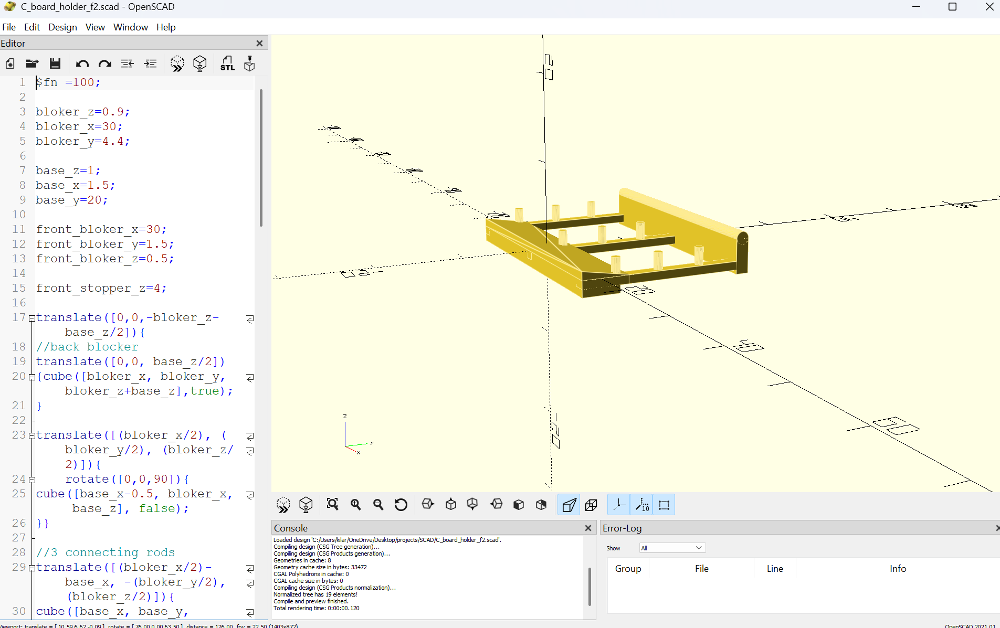

# Cutting Board Holder

A parametric, 3D-printable holder designed in OpenSCAD. Placed against a wall, it prevents cutting boards from sliding and falling off the counter.

---

## Features

- **Fully Parametric:** Easily adjust dimensions (width, depth, thickness) in OpenSCAD to fit your specific boards.
- **Sturdy Structure:** Includes alignment pins and an angled base wedge for added stability.
- **Easy to Print:** Features rounded front edges and prints cleanly with standard PLA settings without unnecessary support.

---

## Recommended Print Settings

Tested on a Creality CR-10S using Ultimaker Cura:

- **Layer Height:** 0.2mm
- **Infill:** 15%
- **Material:** PLA

---

## Project Files

- `C_board_holder_f2.scad`: Source OpenSCAD file (edit variables at the top to change sizes).
- `C_board_holder_v4.stl`: Ready-to-print 3D model.

---

## How to Use

1. Open `C_board_holder_f2.scad` in **OpenSCAD** to customize sizes if needed.
2. Render (`F6`) and export as an **STL**.
3. Load the `.stl` file into your slicer, slice, and print.
